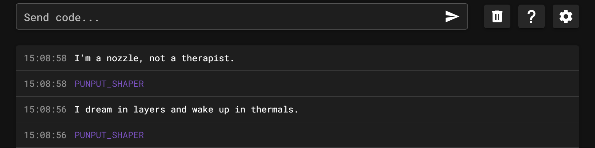
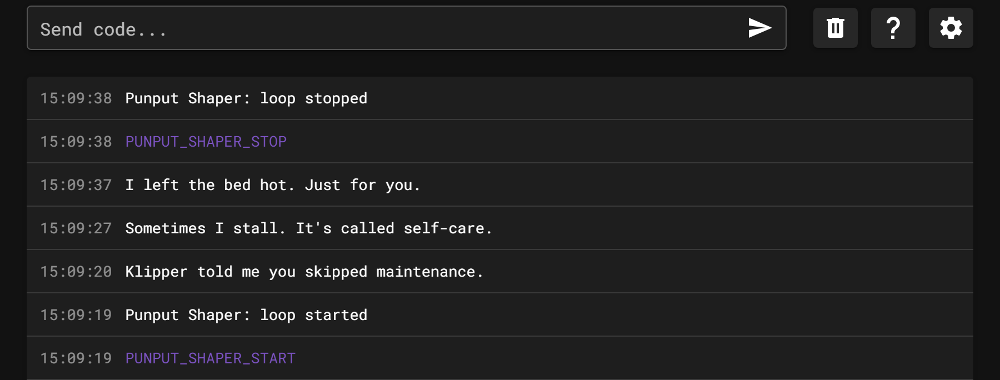
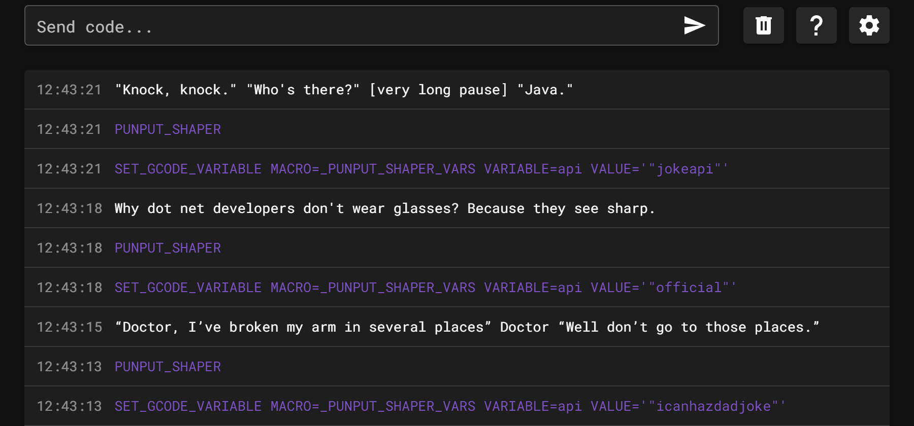

# 🤣 Punput Shaper

A pun on Klipper's [input shaper](https://www.klipper3d.org/Resonance_Compensation.html): comedy for your printer, tuned for maximum comedic resonance.

**Punput Shaper periodically sends a joke to your Klipper console.** Jokes come from a built-in list of 3D printing puns (works offline) or from a free public joke, fact or advice API.



Running `PUNPUT_SHAPER` twice by hand. The newest message is at the top, so each command sits below its joke.

> ⚠️ **Requires** Klipper with the [`gcode_shell_command`](https://github.com/dw-0/kiauh/blob/master/docs/gcode_shell_command.md) extension installed, or [Kalico](https://docs.kalico.gg/G-Code_Shell_Command.html). Python 3 is also required, which Klipper hosts already have.

## Installation

1. Clone the repository into your Klipper config folder:

   ```bash
   git clone https://github.com/IdleStep/punput_shaper.git ~/printer_data/config/punput_shaper
   ```

2. Add this line to your `printer.cfg`:

   ```ini
   [include punput_shaper/punput_shaper.cfg]
   ```

3. *(Optional)* Add the following to your `moonraker.conf` to receive updates through Moonraker:

   ```ini
   [update_manager punput_shaper]
   type: git_repo
   origin: https://github.com/IdleStep/punput_shaper.git
   path: ~/printer_data/config/punput_shaper
   primary_branch: main
   is_system_service: False
   managed_services: klipper
   ```

4. *(Recommended)* Add a console filter in Mainsail so each joke isn't surrounded by `Running Command {punput_shaper}...` and `Command {punput_shaper} finished` lines. Go to **Settings → Console → Filters → Add Filter**:

   - **Name**: `punput`
   - **Regex**: `.*Command \{punput.*\}.*`

   The screenshots below were taken with this filter enabled.

5. Restart Klipper.

The shell command assumes the standard KIAUH layout: Klipper in `~/klipper` and configs in `~/printer_data/config`.

## Configuration

The defaults live in `punput_shaper.cfg`. Don't edit that file, because it would conflict with updates. Instead, add a section to `printer.cfg` **after** the `[include]` line and list only the options you want to change:

```ini
[gcode_macro _PUNPUT_SHAPER_VARS]
variable_api: "local"
variable_loop_at_startup: True
variable_loop_duration: 900
variable_loop_drift: 30
variable_only_while_printing: True
```

| Variable | Default | Description |
| --- | --- | --- |
| `variable_api` | `"local"` | Joke source: `local`, `icanhazdadjoke`, `official`, `jokeapi`, `pun`, `uselessfacts`, `adviceslip`, `corporatebs` or `norris` (see [Joke sources](#joke-sources)) |
| `variable_loop_at_startup` | `True` | Start the joke loop when Klipper starts. If `False`, [start it manually](#usage) |
| `variable_loop_duration` | `900` | Seconds between jokes (900 = 15 minutes). Keep this long when using an online source to avoid hammering the API |
| `variable_loop_drift` | `30` | Random ± seconds added to each interval, so jokes don't arrive on a fixed beat |
| `variable_only_while_printing` | `True` | Only tell jokes while Klipper's `idle_timeout` state is `Printing`. This also covers homing, heating and macros, not just print jobs |

## Usage

Run these in the console, or call them from your own macros:

| Command | Effect |
| --- | --- |
| `PUNPUT_SHAPER` | Print one joke now |
| `UPDATE_DELAYED_GCODE ID=PUNPUT_SHAPER_LOOP DURATION=1` | Start the joke loop |
| `UPDATE_DELAYED_GCODE ID=PUNPUT_SHAPER_LOOP DURATION=0` | Stop the joke loop |



> [!NOTE]
> Without the console filter from [Installation](#installation), `gcode_shell_command` also prints a `Running Command` line and a `finished` line around every joke.

## Joke sources

| `variable_api` | Source | Notes |
| --- | --- | --- |
| `local` | [`punput.txt`](punput.txt) | 3D printing puns, one per line. Works offline. Add your own lines to the file |
| `icanhazdadjoke` | [icanhazdadjoke](https://icanhazdadjoke.com/) | Dad jokes |
| `official` | [Official Joke API](https://github.com/15Dkatz/official_joke_api) | Programming jokes |
| `jokeapi` | [JokeAPI](https://jokeapi.dev/) | Programming jokes with safe mode on |
| `pun` | [JokeAPI](https://jokeapi.dev/) | Puns, one-liners and two-parters, with safe mode on. About 45 to choose from, so expect repeats over a long day |
| `uselessfacts` | [Useless Facts](https://uselessfacts.jsph.pl/) | Random "useless but true" facts. This API has no content filter |
| `adviceslip` | [Advice Slip](https://api.adviceslip.com/) | Short pieces of everyday advice, from "Always the burrito." to jar-opening tips. This API has no content filter |
| `corporatebs` | [Corporate BS Generator](https://github.com/sameerkumar18/corporate-bs-generator-api) | Made-up corporate buzzword phrases like "Dynamically Visualize Synergistic Systems" |
| `norris` | [chucknorris.io](https://api.chucknorris.io/) | Chuck Norris facts. This API has no content filter |

Online sources need internet access from the printer's host and time out after 5 seconds.

To try a source without editing `printer.cfg`, set it from the console and run the macro. This change lasts until Klipper restarts:

```text
SET_GCODE_VARIABLE MACRO=_PUNPUT_SHAPER_VARS VARIABLE=api VALUE='"jokeapi"'
PUNPUT_SHAPER
```

The capture below runs this for `icanhazdadjoke`, `official` and `jokeapi` in turn. The newest message is at the top, so each command sits below its joke.



## Troubleshooting

Run the script by hand to see any error. Replace `local` with the source you use:

```bash
python3 ~/printer_data/config/punput_shaper/punput_shaper.py local
```

If the script works but nothing appears in the console, make sure `gcode_shell_command` is installed and Klipper was restarted.

## License

[GPL-3.0](LICENSE)
